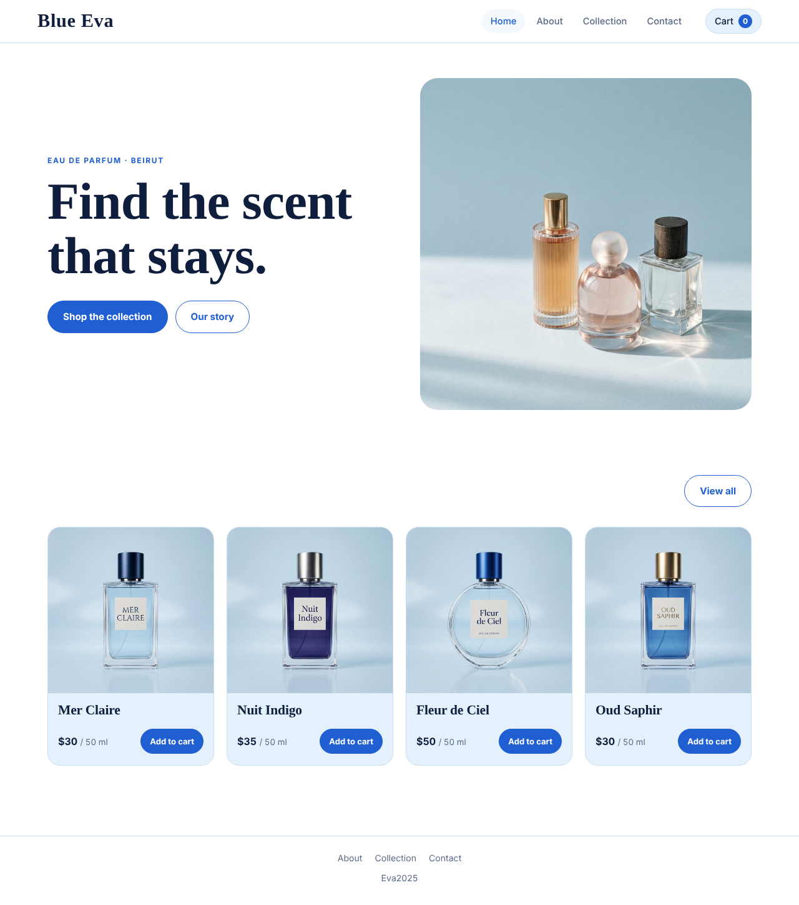
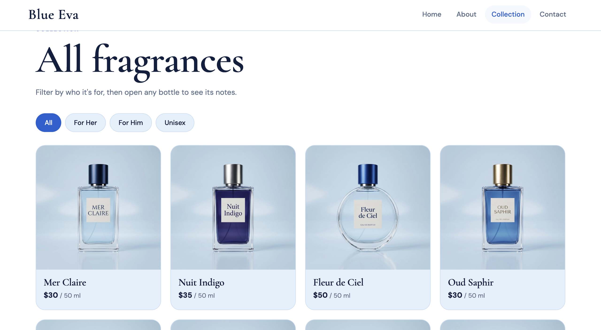
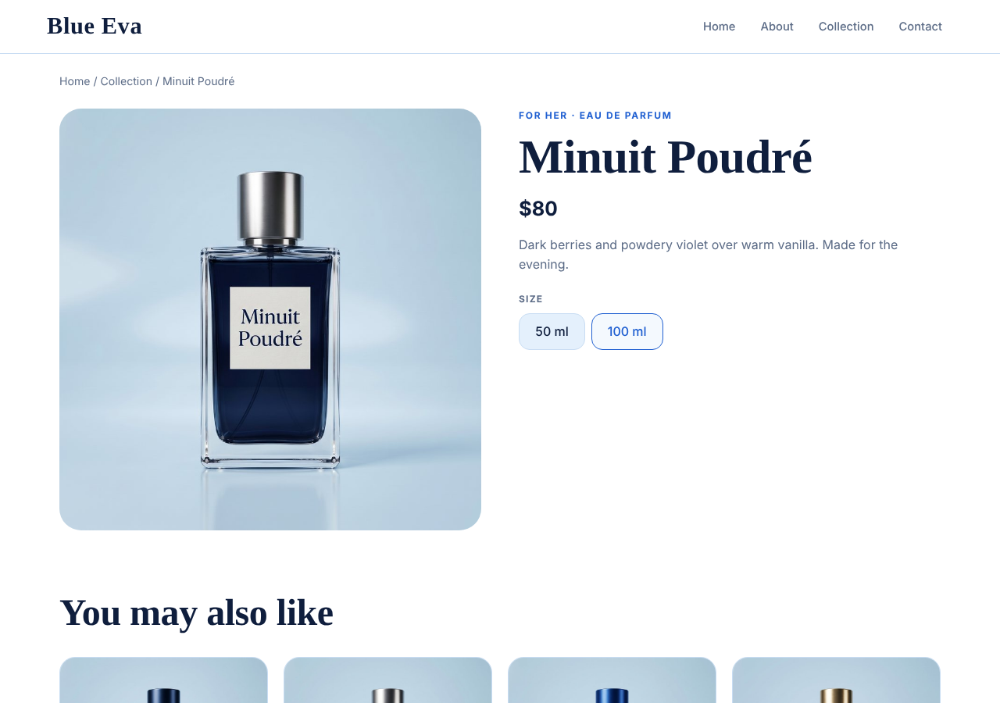
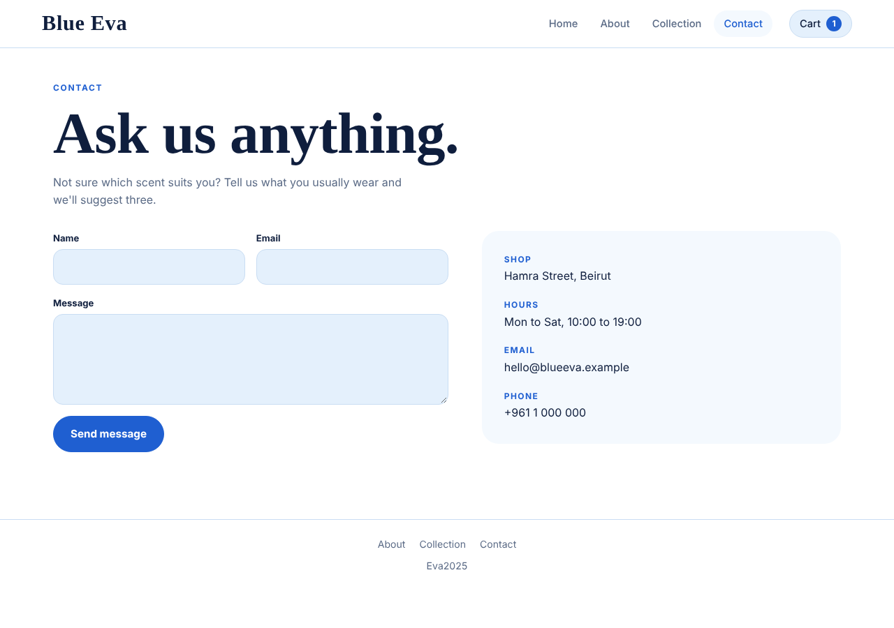

# Blue Eva: Perfume Shop (CSCI426 Project Phase 1)

A responsive front-end web application for a perfume shop, built with **React** and **react-router-dom**.
Visitors can browse eight fragrances, filter them by category, open a detail page for each perfume,
and send a message through the contact form.

## Pages

| Page | Route | Description |
|---|---|---|
| Home | `/` | Hero section and bestsellers |
| About | `/about` | The Blue Eva story |
| Collection | `/collection` | All perfumes with a category filter (the shop's catalog) |
| Product detail (dynamic page) | `/product/:id` | One perfume: size (50/100 ml) and price, related perfumes |
| Contact | `/contact` | Contact form and shop details |

## React concepts used

- **JSON data:** the catalog is a JSON-style array in `src/data/products.jsx`, imported by `App.jsx` and passed to the pages as props.
- **useState:** category filter, selected size, contact form fields.
- **useEffect:** page titles, resetting the size when another perfume opens, scrolling to the top on route change.
- **React Router:** `BrowserRouter`, `Routes`, `Route`, `Link`, `NavLink`, `useParams` for the dynamic page.
- **localStorage + JSON:** `src/App.jsx` saves contact messages with
  `JSON.stringify()` and reads them with `JSON.parse()` inside `try/catch`.
- **Events:** `onClick`, `onChange` and `onSubmit` (with `preventDefault()`).
- **Responsive design:** CSS grid and flexbox, tested at desktop and phone widths.

## Project structure

```
src/
  components/   Navigation, Footer, ProductCard, ScrollToTop
  pages/        Home, About, Collection, ProductDetail, Contact
  App.jsx       routes
  main.jsx      entry point
  data/         products.jsx (perfume data)
  assets/       product photos
public/         _redirects (Netlify)
```

## Setup

Requires Node.js 18 or newer.

```bash
npm install
npm run dev       # development server
npm run build     # production build in /dist
npm run preview   # preview the production build
```

## Deployment

- **Vercel:** import the GitHub repository. `vercel.json` already sends every route to `index.html`.
- **Netlify:** `public/_redirects` does the same.
- **GitHub Pages:** set `base: "/<repo-name>/"` in `vite.config.js` and replace `BrowserRouter` with
  `HashRouter` in `src/App.jsx`, because GitHub Pages cannot rewrite routes.


## Screenshots

### Home


### Collection


### Product Detail


### About


### Contact


### Mobile View


## Credits

Course tutorials: React Events, Hooks, useState, useEffect, useContext; JSON, React and Local Storage; React Books App; React Forms.
Product photos were generated with Flow AI
